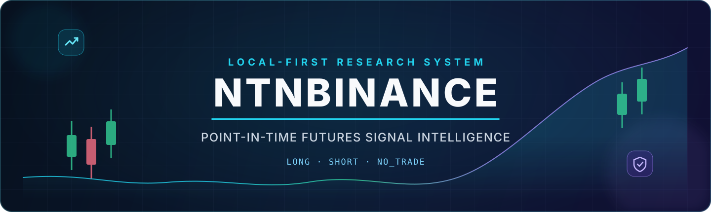
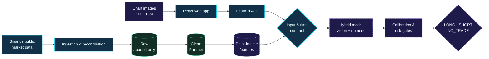

<div align="center">
  
</div>

<div align="center">
  <br />
  <a href="plan.md"></a>
  <a href="reports/data-quality.md"></a>
  
  
</div>

<div align="center">
  <br />
  <strong>A local-first research system for Binance USDⓈ-M Futures signals.</strong>
  <br />
  Combines 1H + 15m candlestick-chart images with point-in-time market data to produce
  <code>LONG</code> · <code>SHORT</code> · <code>NO_TRADE</code> research signals.
  <br /><br />
  <a href="#-quick-start"><strong>Quick start</strong></a>
  &nbsp;·&nbsp;
  <a href="docs/PRD.md"><strong>Product spec</strong></a>
  &nbsp;·&nbsp;
  <a href="plan.md"><strong>A–Z roadmap</strong></a>
  &nbsp;·&nbsp;
  <a href="docs/DATA_CONTRACT.md"><strong>Data contract</strong></a>
</div>

> [!IMPORTANT]
> **Research and paper trading only.** NTNBINANCE does not place live orders, does not require a Binance trading key, and is not financial advice. The prediction pipeline is still under construction; completed stages are tracked by evidence-backed gates in [`plan.md`](plan.md).

---

## ✦ Why NTNBINANCE?

Most trading prototypes optimize for a promising chart. NTNBINANCE starts with the harder foundations: reproducibility, point-in-time correctness, explicit uncertainty and safe abstention.

| Principle | What it means here |
|---|---|
| **Point-in-time correct** | A candle is usable only when it is closed and was actually available at `decision_time`. |
| **Abstention by design** | `NO_TRADE` is a first-class outcome—not an error or an afterthought. |
| **Local & private** | API, UI, data and artifacts stay on the operator's machine by default. |
| **Zero new cash cost** | No paid API, cloud, database, GPU, domain or required SaaS. |
| **Evidence-gated delivery** | A roadmap stage is completed only when its tests and acceptance evidence pass. |

### Project at a glance

| | |
|---|---|
| **Market** | Binance USDⓈ-M Perpetual Futures |
| **MVP universe** | `BTCUSDT` · `ETHUSDT` |
| **Primary input** | Matching 1H + 15m chart images and market context |
| **Output contract** | `LONG` · `SHORT` · `NO_TRADE` |
| **Forecast horizon** | 4 × 15m candles; 2 and 8 candles are secondary analysis |
| **Runtime** | Windows · local loopback only |
| **Current milestone** | Stage F complete · Stage G next |
| **New cash cost target** | **0 VNĐ** |

---

## ◈ Target architecture



Solid components have a working foundation. Dashed components describe the gated target architecture and must not be treated as production-ready until their roadmap stages pass.

### Technology foundation

<div align="center">
  
  
  
  
  
  
</div>

---

## ⚡ Quick start

### Requirements

- Windows 11 or a compatible Windows environment
- Python `3.14.x`
- Node.js `24.x` and npm `11.x`
- Git and PowerShell

Docker is not required. Project execution never depends on global Python packages.

### 1 · Clone and bootstrap

```powershell
git clone https://github.com/TrungNguyenIT-SE/NTNBINANCE.git
Set-Location NTNBINANCE
powershell -NoProfile -ExecutionPolicy Bypass -File scripts\setup.ps1
```

The bootstrap creates `.venv`, installs exact-pinned Python and frontend dependencies, and configures local Git hooks.

### 2 · Verify the workspace

```powershell
powershell -NoProfile -ExecutionPolicy Bypass -File scripts\quality.ps1
powershell -NoProfile -ExecutionPolicy Bypass -File scripts\smoke.ps1
```

Expected smoke result:

```text
backend-smoke: PASS
frontend-smoke: PASS
stage-c-smoke: PASS
```

### 3 · Run locally

Open two PowerShell terminals:

```powershell
# Terminal 1 — API
powershell -NoProfile -ExecutionPolicy Bypass -File scripts\start-api.ps1
```

```powershell
# Terminal 2 — Web
powershell -NoProfile -ExecutionPolicy Bypass -File scripts\start-web.ps1
```

| Service | Local address |
|---|---|
| Web application | [`http://127.0.0.1:5173`](http://127.0.0.1:5173) |
| API health | [`http://127.0.0.1:8000/health/ready`](http://127.0.0.1:8000/health/ready) |
| OpenAPI docs | [`http://127.0.0.1:8000/docs`](http://127.0.0.1:8000/docs) · development profile only |

<details>
<summary><strong>Runtime profiles</strong></summary>

<br />

| Profile | API | Docs | Runtime root | Purpose |
|---|---|---:|---|---|
| `local-dev` | `127.0.0.1:8000` | On | `var/dev` | Development |
| `local-test` | `127.0.0.1:8010` | Off | `var/test` | Automated tests |
| `local-release` | `127.0.0.1:8000` | Off | `var/release` | Private local release |

```powershell
$env:NTN_PROFILE = "local-release"
powershell -NoProfile -ExecutionPolicy Bypass -File scripts\start-api.ps1
```

Every profile rejects non-loopback hosts. Public exposure is outside the MVP.

</details>

---

## ◆ Data integrity before prediction accuracy

The Stage F pipeline makes data validation, quarantine and resampling executable instead of leaving them as documentation.

```text
schema_version == supported_version
is_closed == true
close_time + 1 ms <= decision_time
event_time <= decision_time
ingested_at <= decision_time
no critical quality flag
```

Late observations, future events, open candles, duplicate keys and unsupported schemas fail closed. If required 15m/1h context is unavailable, the eventual inference path must return `NO_TRADE` rather than use incomplete data.

```powershell
.venv\Scripts\python.exe -m pytest tests\data_contract --no-cov
powershell -NoProfile -ExecutionPolicy Bypass -File scripts\data-quality.ps1
```

Read the full [`Data Dictionary`](docs/DATA_DICTIONARY.md), [`Data Contract`](docs/DATA_CONTRACT.md), [`Data-quality policy`](docs/DATA_QUALITY.md) and [`Stage F acceptance report`](reports/data-quality.md).

---

## ✓ Quality gates

One command validates the complete repository:

```powershell
powershell -NoProfile -ExecutionPolicy Bypass -File scripts\quality.ps1
```

| Gate | Current result |
|---|---:|
| Ruff lint + format | ✅ Pass |
| mypy strict | ✅ Pass |
| Python dependency consistency | ✅ Pass |
| Pytest | ✅ 114 passed |
| Statement + branch coverage | ✅ 91.09% |
| ESLint + Prettier | ✅ Pass |
| TypeScript | ✅ Pass |
| Vitest | ✅ 5 passed |
| Vite production build | ✅ Pass |

Pre-commit and pre-push hooks enforce the same critical checks locally. Clean-checkout evidence is recorded in [`reports/setup-smoke.txt`](reports/setup-smoke.txt).

---

## ◫ Repository map

```text
NTNBINANCE/
├── apps/web/             # React + Vite + TypeScript client
├── configs/              # Versioned local runtime profiles
├── data/                 # Git-ignored raw, clean and feature data
├── docs/                 # Product, decisions and data contracts
├── models/               # Git-ignored model artifacts and registry
├── reports/              # Reproducible test/research evidence
├── scripts/              # Setup, quality, smoke and run commands
├── src/ntnbinance/       # FastAPI backend and executable contracts
├── tests/                # Backend and invariant test suites
├── var/                  # Local databases, uploads and runtime state
├── plan.md               # Evidence-gated A–Z delivery plan
└── requirements.lock     # Fully pinned Python environment
```

---

## ◉ Delivery status

The project follows 26 sequential stages. A stage is checked only after every child task and its Exit Gate have verifiable evidence.

| Track | Stages | Status |
|---|---|---|
| Product scope & zero-cost constraints | A–B | ✅ Complete |
| Repository & data contract foundation | C–D | ✅ Complete |
| Market-data pipeline & quality | E–F | ✅ Complete |
| Labels, splits, baseline & backtest | G–J | ○ Planned |
| Image + numeric intelligence | K–P | ○ Planned |
| Risk, API & web product | Q–S | ○ Planned |
| System validation & operations | T–W | ○ Planned |
| Security, acceptance & release | X–Z | ○ Planned |

**Overall progress:** `6 / 26 stages` · `23.08%`

**Next gate:** Stage G — define and validate prediction labels

Follow the live checklist in [`plan.md`](plan.md).

---

## ◇ Security, privacy & zero-cost policy

- No Binance trading key is needed for the MVP's public market data.
- Live order placement is outside the approved scope.
- `.env`, uploads, databases, Parquet files and model artifacts are excluded from Git.
- Runtime services bind to `127.0.0.1`; unsafe hosts are rejected by configuration.
- No required cloud, paid API, domain, GPU rental or hosted database.
- Free tiers are not treated as mandatory infrastructure.
- Simulation still models fees, spread, funding and slippage—“zero-cost project” does not mean “zero market friction.”

See [`ZERO_COST.md`](docs/ZERO_COST.md), [`HARDWARE.md`](docs/HARDWARE.md), [`.gitignore`](.gitignore) and [`THIRD_PARTY_LICENSES.md`](THIRD_PARTY_LICENSES.md).

> [!CAUTION]
> Financial markets are high risk. Model confidence is not certainty, historical performance is not a guarantee, and no output from this repository should be interpreted as a recommendation to trade or invest.

---

## 📚 Documentation

| Document | Purpose |
|---|---|
| [`PRD.md`](docs/PRD.md) | Product scope, users, outputs and acceptance criteria |
| [`plan.md`](plan.md) | Full A–Z execution plan and live checklist |
| [`DATA_DICTIONARY.md`](docs/DATA_DICTIONARY.md) | Fields, types, keys, units and source semantics |
| [`DATA_CONTRACT.md`](docs/DATA_CONTRACT.md) | UTC, availability, storage and retention rules |
| [`INGESTION.md`](docs/INGESTION.md) | Public REST/WebSocket operations, recovery and raw audit |
| [`DATA_QUALITY.md`](docs/DATA_QUALITY.md) | Validation, quarantine, UTC resampling and idempotent clean publication |
| [`ZERO_COST.md`](docs/ZERO_COST.md) | Enforceable zero-new-cash-cost policy |
| [`HARDWARE.md`](docs/HARDWARE.md) | Local resource budget and benchmark evidence |
| [`decisions/`](docs/decisions/) | Versioned architecture and product decisions |
| [`THIRD_PARTY_LICENSES.md`](THIRD_PARTY_LICENSES.md) | Dependency license inventory and review process |

---

<div align="center">
  <strong>Built for disciplined research—not impulsive trading.</strong>
  <br />
  <sub>Local first · Point-in-time correct · Evidence gated · 0 VNĐ new cash cost</sub>
</div>
